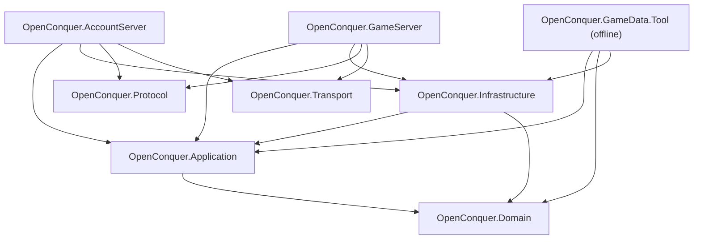

# Architecture overview

OpenConquer is a modular monolith. Each project owns one concern, dependencies point inward, and
every piece of mutable runtime state has a single owner.

## Projects and dependencies



| Rule                                                                                           |
| ---------------------------------------------------------------------------------------------- |
| Domain depends on nothing else in the solution.                                                |
| Application depends on Domain only. It defines the contracts Infrastructure implements.        |
| Protocol and Transport depend on neither each other nor on Application or the hosts.           |
| Hosts are composition roots: they wire concrete implementations to Protocol and Transport.     |
| The content tool is offline only. Neither server references it or reads client data files.     |

Add a new project only when a dependency, deployment, or reuse need calls for the split.

## Layering inside a host

```text
client ⇄ Transport ⇄ Protocol ⇄ host session ⇄ Application ⇄ world runtime
```

Transport moves bytes and owns sockets, buffers, and backpressure. It never interprets packets.
Protocol turns bytes into packets and back, and never owns sockets or queues. The host session sits
between them and owns the lifetime of one connection. See [Networking](networking.md).

## Ownership

| Resource                       | Owner                                                         |
| ------------------------------ | ------------------------------------------------------------- |
| TCP listener                   | The host's runtime hosted service                             |
| Accepted connection            | Transport, then the admission queue, then a connection session |
| Login or game session          | The worker processing that connection                         |
| Admitted world session         | `WorldSession`, supervised independently of login workers     |
| Frame memory                   | The caller that requested the read or write                   |
| `DbContext`                    | A single repository operation                                 |
| Mutable map state              | The `WorldPartition` that hosts the map                       |

Ownership is handed over at defined points, including on failure paths. A component that fails
while holding a connection disposes it instead of leaving it half-initialized. Borrowed memory never
outlives its owner.

## Capacity limits

Every handoff between a producer and a consumer has a fixed capacity and a defined behavior when it
is full. Connection admission, login workers, authentication, ticket cleanup, partition command
queues, and world session cleanup all have limits. Depending on the work, overload means rejecting,
applying backpressure, disconnecting, or shedding work. Nothing grows without limit.

## Failure handling

| Situation                                      | Behavior                                                        |
| ---------------------------------------------- | --------------------------------------------------------------- |
| Database or content readiness fails at startup | The host exits before opening a listener                        |
| A packet reader fails                          | The reader's position is unchanged                              |
| A packet writer or frame encoder fails         | Nothing partial is committed and the attempted region is zeroed |
| A ticket grant or redemption is in doubt       | Success is reported only after the commit succeeds              |
| A login step fails on either server            | The connection is closed and no partial session is exposed      |
| Two writes overlap on a GameServer connection  | The second write is rejected immediately                        |
| A background service fails                     | The host shuts down and exits with a nonzero code               |

Commits whose outcome is unknown are never retried blindly.

## Time

| Purpose                                          | Clock                                   |
| ------------------------------------------------ | --------------------------------------- |
| Durations, scheduling, rate limiting             | Monotonic time via `TimeProvider`       |
| Ticket issue and expiry                          | The MySQL server clock                  |
| Item lifetimes during login                      | One UTC instant captured per request    |
| Maintenance intervals                            | Injected process time                   |

## Scaling

The first deployment is one AccountServer and one GameServer. The AccountServer holds no player
state and can be restarted freely. The GameServer runs many world partitions in one process
across a shared worker pool. Partitions could later be spread across processes, but only once
measurements show the need. See [World execution](world-execution.md).

## Further reading

- [Networking](networking.md)
- [Authentication](authentication.md)
- [Account registration](account-registration.md)
- [Persistence](persistence.md)
- [World execution](world-execution.md)
- [Connected portal transfers](connected-portal-transfers.md)
- [Protocol](../protocol/README.md)
