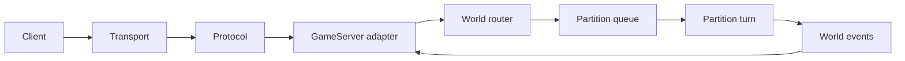

# World execution

In the GameServer, clients send requests and the server decides what happens. Every piece of
mutable world state has exactly one owner at a time. For anything spatial, that owner is a
`WorldPartition`.

## What exists today

The runtime lives in `src/OpenConquer.GameServer/World/Execution`.

- `WorldRuntime` builds one `WorldPartition` per map from the validated `WorldMapContentCatalog`.
  Each partition holds one `MapInstance` that keeps a reference to the map's content, collision,
  and terrain. Map ID, terrain ID, and flags are kept separate, and there is no fallback map.
- `WorldScheduler` runs partitions on a fixed pool of workers. Each partition has a FIFO command
  queue of fixed capacity. A partition is queued for execution at most once at a time, runs for at
  most `MaxCommandsPerTurn` commands, and is requeued if work remains. Different partitions run in
  parallel; one partition never runs two turns at once.
- `WorldRuntime.AdmitCharacterAsync` reserves the character across all partitions, checks that the
  map exists and the position is inside the map, and returns a `WorldCharacterOwnership` token
  holding the character ID, map, a generation number, and the runtime instance. Reads, walking,
  and removal require the full token, so a stale token cannot affect a newer admission. The
  admission position check is bounds only; it does not decide walkability.
- `WorldRuntime.TryWalkCharacterAsync` enqueues one 5517 ground step. The partition computes the
  destination from the server's position and the 5517 direction table, checks composed static
  collision, and commits both coordinates together. A refused step returns `null` without changing
  the position. `WorldSession` calls it for walking packets from the client after checking the
  session, pacing and replay, then acknowledges the step and relays it to nearby players; see
  [ground-walking.md](ground-walking.md) and [player-visibility.md](player-visibility.md).
- `WorldSessionAdmissionProcessor` takes a connection that has finished the login sequence,
  confirms its map is the same object the runtime holds, admits the character, and returns a
  `WorldSession` that owns both the connection and the ownership token.

| Setting                  | Meaning                                         |
| ------------------------ | ----------------------------------------------- |
| `WorkerCount`            | Scheduler threads                               |
| `PartitionQueueCapacity` | Ordinary commands queued per partition          |
| `MaxCommandsPerTurn`     | Commands a partition runs before yielding       |
| `MaxCharacters`          | Characters resident across the world            |
| `MaxCharactersPerMap`    | Characters resident per map                     |

A map holds only resident characters and their positions. There is no timed tick loop, combat, or
replication of NPCs, monsters or ground items yet. See [ground-walking.md](ground-walking.md) for
the client sources and what walking covers.

### Cancellation, cleanup, and shutdown

Cancellation is honored only before a command is accepted. After that, the command runs and its
result must be observed, so a cancelled caller cannot leave a half-admitted character or a
half-applied walk.

A full command queue rejects new work immediately. Removals use a separate high-priority lane
sized to the map's character limit, with at most one pending removal per character, so a busy map
can always process disconnects.

A `WorldSession` is cleaned up once, whether triggered by disposal, presence revocation, or runtime
shutdown. Cleanup closes the connection and releases the character even if the caller has stopped
waiting, and reports both failures if both steps fail. A new login for a character that is still
being released fails rather than waiting or retrying.

On shutdown the runtime rejects new work, fails queued commands, lets running turns finish, joins
the workers, clears map state, and waits for open sessions. A stopped runtime cannot be restarted.

## Design rules

These rules govern the parts still to be built.

1. Every mutable aggregate has one owner. Spatial state belongs to a partition; guilds, realm
   presence, rankings, and similar systems get their own owners.
2. A partition hosts one map for now. Small maps may share a partition later; splitting a map
   across partitions is out of scope unless profiling shows a single map cannot keep up.
3. A partition never runs two turns at once, and a busy partition yields after a limited turn.
4. Network sessions submit commands. They never hold or mutate gameplay state.
5. Commands carry IDs and values, never references to sessions, EF entities, or another
   partition's objects. Partitions talk to each other with immutable messages.
6. Every queue has a size limit. Important commands are never dropped silently. Superseded or
   low-value work may be coalesced or shed where the game allows it.
7. A world turn never awaits a database, socket, file, or other external call. It issues a
   request and handles the result later as a new command.
8. The world emits events. The GameServer turns events into packets for the affected
   connections, so sockets and encryption stay outside the simulation.
9. Visibility is computed per partition from a spatial index, so cost grows with nearby entities,
   not total population.
10. Durations use monotonic time, and randomness that affects outcomes goes through a game RNG,
    so a world transition can be replayed in tests from its initial state, commands, time, and
    random state.
11. Moving a character between maps is an ownership transfer with an operation ID and a new
    generation, so retries and late messages cannot act on the wrong owner.

## Command flow



A movement packet means "request this movement", not "set my position". The partition validates
it against the current position, terrain, character state, elapsed time, and active effects. The
eight-direction map-local coordinate primitive now exists, but its complete movement validation,
packet route, server event publication, and replication do not. The same requirements apply
to combat, items, trading, and NPC interaction.

Timed systems such as AI, regeneration, status effects, cooldowns, and respawns run as scheduled
partition work instead of a global loop, so idle maps cost nothing. Catch-up work after a delay is
limited per turn.

## Durable operations

Some actions, such as item transfers or currency changes, must not be acknowledged before they
are saved. They follow a pending-commit pattern:

```text
validate → mark pending → submit write → completion command → finalize or roll back
```

The rest of the partition keeps running while the write is outstanding.

## Ordering

Ordering is local. TCP orders bytes within a connection. A partition runs its accepted commands in
order and can number them for diagnostics. Each connection has one ordered send path. There is no
global order across the realm, so cross-partition operations use messages and operation IDs.

## Map transfers

A character has at most one active owner. A transfer marks the character as moving in the source
partition, prepares the destination, releases the source, and activates the character in the
destination with a new generation before publishing the new owner. This protocol assumes a single
process; spreading partitions across processes would need additional fencing and recovery.

## Scaling and hot maps

Partitions share the worker pool, so maps run in parallel without concurrent mutation inside a
map. A single busy map has a serial ceiling by design. The response to a hot map is to measure and
optimize visibility queries, fan-out, allocations, AI, combat, and packet generation before
considering finer-grained ownership. Moving partitions to other processes is possible later and
should be driven by scheduling lag, CPU, memory, and network measurements rather than player
count alone.
